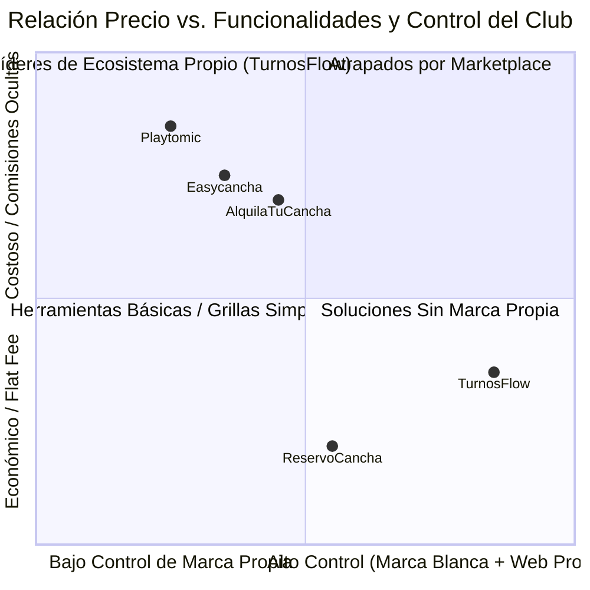

# Análisis Comparativo de Precios y Posicionamiento: TurnosFlow vs. Referentes del Sector

Este informe analiza la estructura de precios actual de **TurnosFlow**, la compara con los líderes de Argentina y el mercado internacional (Playtomic, AlquilaTuCancha, ReservoCancha, Easycancha), y evalúa la viabilidad comercial y el atractivo para los dueños de complejos.

---

## 1. Estructura Actual de TurnosFlow

| Característica | Plan Bronce | Plan Plata (Recomendado) | Plan Oro (Full) |
| :--- | :---: | :---: | :---: |
| **Precio Base Mensual** | **$29 USD** (~$35.000 - $40.000 ARS) | **$59 USD** (~$70.000 - $80.000 ARS) | **$99 USD** (~$120.000 - $135.000 ARS) |
| **Canchas Base Incluidas** | 2 canchas | 4 canchas | 6 canchas |
| **Cancha Adicional** | +$8 USD / mes | +$10 USD / mes | +$12 USD / mes |
| **Comisión Marketplace** | 5% por turno captado | 5% por turno captado | 5% por turno captado |
| **Prueba Gratuita** | 30 días sin tarjeta | 30 días sin tarjeta | 30 días sin tarjeta |
| **Módulos Clave** | Agenda + Web SEO Propia | Agenda + Web + POS/Buffet + Turnos Fijos + Split Payment | Todo lo anterior + Domótica Luces IoT + Torneos/Fixtures |

---

## 2. Comparativa Frente a los Principales Referentes

### A. AlquilaTuCancha (ATC Manager) — *Líder en Argentina*
* **Precios:**
  * Plan Base: **~$57.000 ARS / mes**.
  * Plan con automatizaciones / WhatsApp: **~$114.000 ARS / mes**.
* **Modelo:** Suscripción mensual fija + comisiones en pagos procesados dentro de la app ATC.
* **Ventajas:** Mucho tráfico orgánico de jugadores que ya tienen la app instalada.
* **Desventajas para el club:** El club "alquila" su tráfico; los usuarios son de AlquilaTuCancha, no del club. Si el club no paga, pierde su base de datos. Poca personalización institucional.

### B. Playtomic — *Líder Global (España, Europa, Latam)*
* **Precios:**
  * Plan Standard: Desde **~$38 USD / mes** (escala rápido con más canchas).
  * Planes Pro / Master: **$150 - $280+ USD / mes**.
  * Cobran **costos de transacción y comisiones por reserva online** a los jugadores y al club.
* **Ventajas:** Marca internacional muy fuerte, comunidad de jugadores masiva y sistema de niveles (Playtomic Level).
* **Desventajas para el club:** Muy costoso para complejos medianos o chicos de Argentina; monopoliza la relación con el jugador (el jugador entra a Playtomic, no al sitio web del club).

### C. ReservoCancha / PlayCrew / Turnito — *Herramientas Locales de Entrada*
* **Precios:**
  * Planes escalonados entre **$20.000 y $45.000 ARS / mes**.
* **Modelo:** Solo abono fijo o cero abono cobrando por porcentaje de Mercado Pago.
* **Desventajas:** Funcionalidades muy limitadas (son solo una grilla o calendario). No ofrecen Punto de Venta (POS Buffet), domótica de luces IoT, torneos con cuadros eliminatorios ni sitios web dinámicos SEO para cada complejo.

---

## 3. Matriz Competitiva

| Criterio | **TurnosFlow** | **AlquilaTuCancha** | **Playtomic** | **ReservoCancha** |
| :--- | :---: | :---: | :---: | :---: |
| **Web Propia & Subdominio Exclusivo** | ✅ Sí (`miclub.turnosflow.com`) | ❌ No (perfil dentro de ATC) | ❌ No (perfil en Playtomic) | ⚠️ Landing básica |
| **Dominio Personalizado (`.com`)** | ✅ Sí (soportado nativo) | ❌ No | ❌ No | ❌ No |
| **Control de Buffet & Stock (POS)** | ✅ Sí (Integrado) | ⚠️ Limitado | ⚠️ Módulo extra | ❌ No |
| **Domótica de Iluminación IoT** | ✅ Sí (Plan Oro) | ❌ No | ⚠️ Solo partners caros | ❌ No |
| **Torneos y Brackets Automáticos** | ✅ Sí (Plan Oro) | ⚠️ Requiere app externa | ✅ Sí | ❌ No |
| **Precios Transparentes en Web** | ✅ Sí | ⚠️ Solo vía demo/ventas | ⚠️ Rango variable | ✅ Sí |
| **Días de Prueba Gratuita** | **30 Días** | 14 Días | 14 Días | 0 a 7 Días |

---

## 4. Conclusiones y Recomendaciones Estratégicas

1. **Relación Calidad-Precio Muy Competitiva:**
   * El plan **Bronce ($29 USD)** queda a la par o incluso por debajo de las soluciones básicas locales (~$35.000 ARS), pero ofreciendo una experiencia visual y tecnológica superior (Next.js 14, Web dedicada, multi-tenant).
   * El plan **Plata ($59 USD)** está prácticamente empatado con el plan base de ATC (~$57.000 a $70.000 ARS), pero en TurnosFlow incluye Buffet/POS, Turnos Fijos recurrentes y pagos divididos.
   * El plan **Oro ($99 USD)** es más económico que el paquete PRO de ATC (~$114.000 ARS) y ofrece **Domótica de Luces IoT**, algo que ningún competidor local incluye en su suscripción básica.

2. **Diferenciador Clave de Venta:**
   * En TurnosFlow el club **es dueño de su marca**: tiene su propio link (`padelpro.turnosflow.com` o su `.com`), personaliza sus colores, su portada, administra su propio buffet y sus clientes son suyos.

3. **Recomendación para el Mercado Local (Argentina):**
   * Es una gran ventaja mostrar el precio en **USD como referencia estable**, pero permitiendo abonar en pesos al tipo de cambio oficial/MEP vía Mercado Pago o transferencia bancaria (como ya implementamos en el panel de facturación).
